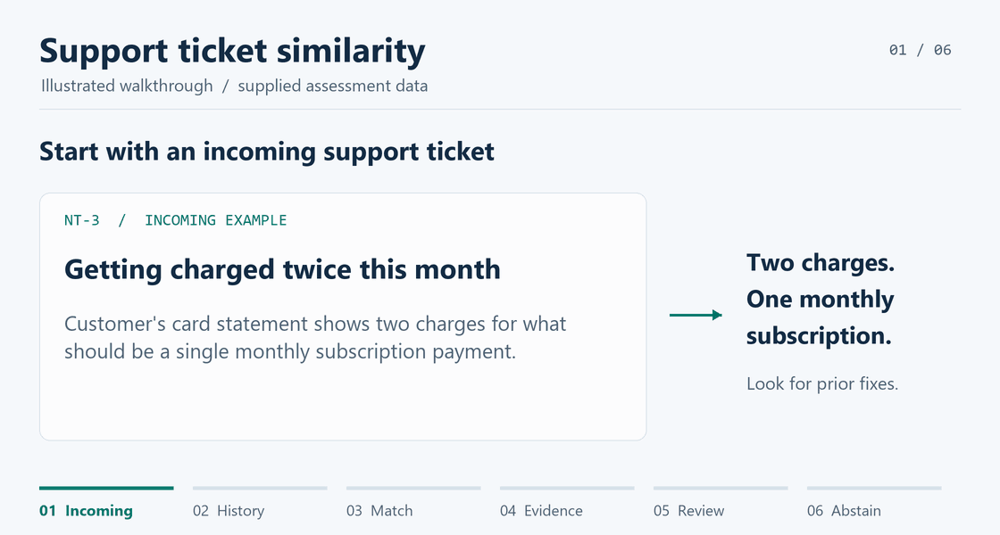

# Support Ticket Similarity Assistant

Solari's support team handles around **150 new tickets a day**. Agents need to find earlier fixes quickly and give consistent answers.

This assistant retrieves related resolved tickets, shows the recorded fixes and matching terms, and can return no suggestions. **The agent decides whether a historical fix applies.**

Built with Python's standard library using the assessment's **40 historical tickets and four incoming examples unchanged**. No third-party packages, model downloads, or API keys are needed to run the application.

## See the flow



*Illustrated walkthrough using supplied cases. The application runs through a terminal and local JSON API.*

[View the static overview without animation](docs/assets/ticket-assistant-walkthrough.png)

## Run the demo

Requires Python 3.11 or newer. From the repository root:

```shell
cd support-ticket-assistant
python -m ticket_assistant demo
python -m unittest discover -s tests -q
```

On Windows, `py -3` may replace `python`; on macOS or Linux, `python3` may be needed.

For a guided live presentation, run `python present_to_panel.py` from the repository root, or double-click `START_PANEL_DEMO.cmd` on Windows. Press Enter between cases. See [Present now](PRESENT_NOW.md) for the speaking sequence.

Batch JSON and HTTP examples are in the [implementation README](support-ticket-assistant/README.md).

## What the four supplied examples show

| Incoming ticket | Actual result | What the agent should understand |
| --- | --- | --- |
| **NT-1** Reset email never arrives | No suggestion | The password-reset history assumes the email arrived. It does not fix email non-delivery. |
| **NT-2** Revenue chart is blank | T-1201 first, then T-1501 | Useful first comparison. The permission-related secondary result is weaker and not labeled relevant. |
| **NT-3** Charged twice | T-1303 first | Review the recorded retry issue, then verify the current payment evidence. |
| **NT-4** Snowflake connection fails | No suggestion | There is no strong Snowflake source in the supplied history. |

## How it works

1. **Validate the input.** Read the incoming subject and description; preserve the original source metadata.
2. **Search eligible history.** Index only resolved tickets with a recorded resolution. BM25 gives titles extra weight.
3. **Check the evidence.** A minimum overlap gate filters weak matches; insufficient evidence can yield an empty result.
4. **Show the sources.** Return original ticket IDs, symptoms, fixes, and matching terms for agent review.

Resolution text and tags are not search features. Scores express ranking, **not confidence**. The system never applies a fix automatically.

## Evidence and limits

| Check | Recorded outcome |
| --- | --- |
| Functional behavior | **65 tests pass**, including real CLI and local API checks. |
| Suggestions for the two supplied examples with useful history | **2 of 3 returned suggestions** are labeled relevant. Labels are local judgments, not a provider answer key. |
| Hard negative | A browser-extension problem still retrieves the wrong chart fix. The evaluator completes with **exit code 1** to expose it. |
| Artificial 55,000-record workload | **544 ms p95 search time**, exceeding the proposed 500 ms end-to-end target before HTTP overhead. |

These checks do not establish customer accuracy or production capacity. The supplied data has no customer identities or resolution dates; neither is invented. Authentication, live helpdesk integration, incremental updates, and realistic scale validation remain future work.

## Review the submission

- [Solution design](support-ticket-assistant/SOLUTION_DESIGN.md) - customer problem, assumptions, architecture, and tradeoffs.
- [Run instructions](support-ticket-assistant/README.md) - CLI, batch processing, schemas, and the local API.
- [Validation and recorded results](support-ticket-assistant/VALIDATION.md) - measurements, retained failures, and reproduction commands.
- [Panel walkthrough](support-ticket-assistant/PANEL_WALKTHROUGH.md) - demonstration sequence and likely questions.
